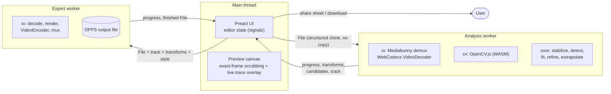
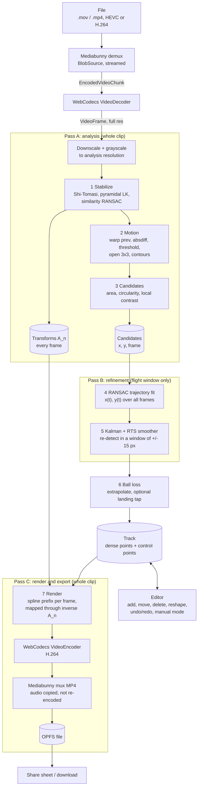
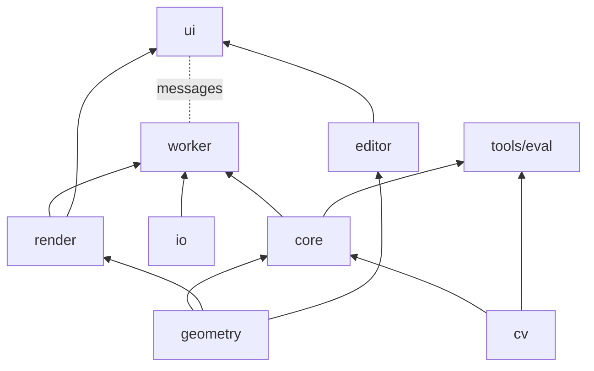

# Architecture

This document describes how shot-tracer turns an existing golf clip into a traced one,
entirely inside the browser. The *why* behind individual choices lives in the
[ADRs](docs/adr/); this document is the *what* and *how*.

Contents:
[1 Constraints](#1-constraints) ·
[2 Runtime topology](#2-runtime-topology) ·
[3 Data flow](#3-data-flow) ·
[4 Coordinate systems](#4-coordinate-systems) ·
[5 The pipeline](#5-the-pipeline) ·
[6 Editing & manual mode](#6-editing-and-manual-mode) ·
[7 Module boundaries](#7-module-boundaries) ·
[8 Memory & performance](#8-memory-and-performance) ·
[9 Capabilities & fallbacks](#9-capabilities-and-fallbacks) ·
[10 PWA & deployment](#10-pwa-and-deployment) ·
[11 Evaluation](#11-evaluation) ·
[12 Risks](#12-risks-and-open-questions) ·
[13 Beyond v1](#13-beyond-v1)

---

## 1. Constraints

**Everything runs client-side. There is no backend.** ([ADR 0001](docs/adr/0001-client-side-only.md))

- Source clips are 150–300 MB (4K60). Uploading them is slower than processing them.
- No upload means no egress cost, no object storage, no accounts, no free-tier abuse
  problem, no GDPR exposure, no queue, no server bill.
- Deployment is a static bundle, free to host indefinitely.
- Users' videos never leave their device — a genuine differentiator in this space.

Further hard constraints:

| Constraint | Consequence |
| --- | --- |
| Must work in iOS Safari | Design to Safari's limits first: tight, silent per-tab memory kills; no ffmpeg.wasm; WebGPU only on iOS 26+. |
| Offline after first load, installable | PWA with a precached app shell and CV runtime. |
| Offline video only (not live) | We can afford several passes over the file; no real-time budget. |
| No ML in v1 | Deterministic classical CV ([ADR 0005](docs/adr/0005-classical-cv-over-ml.md)). |
| Detection *will* fail regularly | The editor is as important as the tracker. |

## 2. Runtime topology



- The main thread never decodes or runs CV. It renders UI, the scrubbable preview, and the
  trace overlay.
- A `File` passed to a worker is a handle, not a copy. Workers read it in slices.
- Analysis and export are separate workers so that a crash or cancellation in one does not
  lose the other's state, and so that OpenCV.js is never loaded during export.

## 3. Data flow

The pipeline makes up to three streaming passes over the file. No pass holds more than a
handful of decoded frames in memory at once.



Passes B and C decode the file again instead of caching frames. Hardware decode is fast,
while caching 4K frames would blow straight through the iOS memory limit (§8).

## 4. Coordinate systems

Getting these wrong is the most common bug in this class of project, so they are fixed
up front and every module states which space it works in.

| Space | Definition | Used by |
| --- | --- | --- |
| **Source `S_n`** | Pixels of frame *n* at full source resolution, **display-oriented** (container rotation already applied), origin at the image's top-left corner. The centre of the top-left pixel is (0.5, 0.5). | Fixtures, editor clicks, rendering, anything persisted |
| **Analysis `a_n`** | `S_n` scaled by `s = analysisHeight / sourceHeight` (default analysis height 1080 px). | Inside `core/` only |
| **Reference `R`** | The source-scale frame of the reference frame *r* (default: first analysed frame). A point that is still in the world has one fixed position in `R`. | Candidates, trajectory, track, editor model |

Transforms are 2×3 similarity matrices (4 DOF: scale, rotation, translation):

- `P_n` maps `S_n → S_{n-1}` (estimated between consecutive frames).
- `A_n = A_{n-1} ∘ P_n` maps `S_n → R`, with `A_r = I`. **Every `A_n` is persisted.**
- Detection happens in `S_n`; candidates are stored in `R` via `A_n`.
- Rendering and editor hit-testing on frame *n* use `A_n⁻¹` to go `R → S_n`.

Pixel-valued tuning parameters (blob area, search window, inlier tolerance) are defined
**at analysis resolution**, so with the default analysis height they mean "px at 1080p".
Conversion between analysis and source scale happens at the `core/` boundary and nowhere
else.

## 5. The pipeline

The algorithm is settled (from the project brief). Deviations are marked and link to
the ADR that records them.

### 5.1 Camera stabilization

- **Features:** `goodFeaturesToTrack` on frame *n−1*, restricted to the **lower two-thirds**
  of the frame (ground and horizon; the sky has no features). Mask height is tunable. Features
  are re-detected when fewer than ~100 survive.
- **Tracking:** `calcOpticalFlowPyrLK` *n−1 → n* (window 21, 3 levels), with a
  forward-backward check. Points whose backward track misses by more than 1 px are dropped.
- **Model:** 4-DOF similarity via RANSAC (2-point minimal sample, least-squares refit on
  inliers). *Deviation:* implemented in TypeScript, because no stock OpenCV.js build exports
  `estimateAffinePartial2D` ([ADR 0003](docs/adr/0003-cv-library-opencv-js.md)). Same
  semantics as OpenCV's function.
- **Persist** `P_n`, `A_n` and the inlier count for every frame. Step 7 needs them again.
- A frame with too few inliers is flagged `unreliable`. Its `P_n` is interpolated from its
  neighbours and the flag is shown in the debug view.
- The golfer's moving body lies in the lower part of the frame too. RANSAC treats it as
  outliers, which is one reason to use a robust estimator here at all.

### 5.2 Motion extraction

- Warp frame *n−1* into `S_n` with `P_n⁻¹` (`warpAffine`, bilinear), then take `absdiff` with
  frame *n*. Mask out the border region that the warp left undefined.
- `threshold` at **25** (tunable), `morphologyEx` open with a **3×3** kernel, then
  `findContours` (external contours only).
- For tripod footage (median inter-frame motion < 0.1 px) the warp is skipped.

### 5.3 Candidate filtering

- Keep blobs with area **2–60 px**, circularity `4πA / P²` **> 0.6**, and a mean intensity
  inside the blob above the surrounding ring by a tunable margin.
- Circularity is meaningless for blobs of a few pixels, so below ~6 px² only the contrast
  test applies.
- Cap the count at ~200 candidates per frame (highest contrast first) to bound step 4.
- **Dozens of false positives per frame are expected and fine.** Do not over-tune this
  step; step 4 provides the robustness. Each candidate stores `frame`, position in `S_n` and
  `R`, area, circularity and contrast.

### 5.4 Trajectory fitting via RANSAC — the core

Pool every candidate from every frame into one list of `(x, y, frame)` in `R`, then:

1. Sample 3 candidates from **3 distinct frames** within a plausible time span
   (≤ 0.5 s of video).
2. Fit the **parametric model** `x(t) = aₓt² + bₓt + cₓ`, `y(t) = a_yt² + b_yt + c_y`, with
   *t* = frame index. Three timed points determine it exactly.
   *Deviation, agreed with the project owner:* the brief's `y = f(x)` only describes
   face-on footage. Down-the-line footage — the common phone angle — climbs nearly
   vertically in the image, and `y = f(x)` breaks there. See
   [ADR 0006](docs/adr/0006-trajectory-model-parametric.md).
3. Reject implausible models cheaply: the ball must initially move upward in the image, and
   speed and acceleration must stay within bounds scaled by fps and resolution.
4. **Score:** for each frame, take the candidate nearest to the predicted position `P(t)`.
   It is an inlier if it lies within τ (≈ 3 px). At most one inlier counts per frame. The score
   is the number of inlier frames in the longest run whose gaps are no more than 3 frames;
   the summed residual breaks ties.
5. Keep the best model (and the top *k* distinct alternatives, which the editor offers as
   "try another track"). Refit by least squares on the inliers.

The brief's two constraints fall out of the model: "monotonically increasing frame index
along the curve" holds by construction, and "roughly constant horizontal velocity" is the
face-on special case (`aₓ ≈ 0`) of velocity being linear in *t*. For face-on footage,
eliminating *t* gives back exactly the brief's parabola.

Implementation notes: candidates are bucketed per frame in a uniform grid, so each
hypothesis costs O(frames), not O(candidates). The PRNG is seeded, which keeps evaluation
runs reproducible. Iterations adapt to the observed inlier ratio (bounded to ~20 k).

### 5.5 Kalman refinement

- **Model:** constant acceleration, state `[x, y, vx, vy, ax, ay]` in `R`, time step
  = 1 frame, initialized from the RANSAC fit. Implemented in TypeScript
  ([ADR 0003](docs/adr/0003-cv-library-opencv-js.md)).
- **Pass B** re-decodes only the flight window (a few frames either side of the inliers).
  Wherever there is no inlier, it maps the prediction to `S_n` and searches a **±15 px**
  window. The threshold is relaxed there and there is no circularity test, which recovers
  weak and motion-blurred detections that step 3 rejected. Measurements are gated by
  Mahalanobis distance.
- A Rauch–Tung–Striebel smoother pass then gives final per-frame positions. Remaining gaps
  of up to a few frames are interpolated.
- Every output point carries its provenance: `detected | refined | interpolated |
  extrapolated | manual`.

### 5.6 Graceful loss of the ball

After roughly 20–40 frames the ball is sub-pixel and gone. We don't fight this:

- **Extrapolate** the fitted curve beyond the last observation toward a landing point.
- **Let the user tap the landing point** — scrub to a frame, tap where the ball comes
  down. That point (mapped into `R` via `A_n`) and its frame constrain the extrapolated
  segment, which joins the observed track with a continuous tangent.
- Without a landing tap, extrapolation runs for a bounded time and ends. The default length
  is tuned against fixtures that have labelled landings.

### 5.7 Rendering

- The track is a **centripetal Catmull–Rom spline** in `R`, parametrized by time.
- For output frame *n*, take the spline prefix up to time *tₙ* (interpolated within the
  frame, so the line grows smoothly). Map every vertex through **`A_n⁻¹`** into `S_n`, then
  draw. **Skipping the inverse transform makes the trace float while the camera moves**;
  a dedicated test covers it.
- Drawing uses Canvas 2D on an `OffscreenCanvas` in the export worker: `drawImage(frame)`,
  then a wide low-alpha stroke for the glow and a narrow core stroke (no `shadowBlur` —
  too slow at 4K). The same draw function renders the live preview on the main thread.
- **Encode:** WebCodecs `VideoEncoder`, H.264 High at source resolution and fps,
  hardware-preferred. If `isConfigSupported` rejects 4K, fall back to 1080p and tell the
  user. *Deviation:* no ffmpeg.wasm fallback
  ([ADR 0002](docs/adr/0002-video-io-webcodecs-mediabunny.md)).
- **Mux:** Mediabunny writes MP4, with audio packets copied from the input (the strike
  sound matters). Output is rendered display-oriented, with rotation 0, and streamed to an
  OPFS file.
- **Save:** Web Share with files (iOS: "Save Video" puts it in Photos), falling back to a
  download link.

## 6. Editing and manual mode

Manual correction is a first-class feature. The automatic pipeline and the editor share one
document model:

```ts
interface TrackDocument {
  clip: ClipInfo                   // dims, fps, rotation, frame count
  transforms: readonly Transform[] // A_n from pass A (read-only)
  detections: readonly Candidate[] // for display only
  controlPoints: ControlPoint[]    // what the user edits
  landing: ControlPoint | null
  style: TracerStyle               // colour, width, glow
}
interface ControlPoint { id: string; frame: number; x: number; y: number /* in R */;
                         kind: 'impact' | 'auto' | 'user' | 'apex' | 'landing'; }
```

- The rendered curve is the time-parametrized spline through `controlPoints`. Automatic
  tracking produces a dense track and then simplifies it into control points (a few dozen
  at most). The editor only ever works on control points.
- **Operations:** scrub to any frame; tap to add a point at that frame; drag to move it;
  delete it; drag the apex/shape handle to reshape the arc; set impact or landing; pick
  another RANSAC hypothesis; reset to the automatic result.
- Taps land in `S_n` and are converted to `R` with `A_n` — the same transform the renderer
  inverts, so a point stays under the finger on every frame.
- **Undo/redo:** immutable document snapshots on a bounded history stack (200 entries).
  The documents are small, so snapshots are simpler and safer than inverse commands.
  ⌘Z/⇧⌘Z on desktop, buttons on mobile.
- **Manual mode** skips detection entirely. It still runs stabilization (skippable for
  tripod shots), because without it the line would float. The user marks impact and landing;
  the app seeds an apex handle at a default height and timing and fits the spline. It must
  work with zero detections — it is the safety net for every failure mode above.
- The editor is framework-agnostic TypeScript (`src/editor/`); the UI subscribes through
  signals.

## 7. Module boundaries

```
src/
  core/      Pure TypeScript pipeline: stabilize, motion, candidates, fit, refine, extrapolate.
             No DOM, no Web APIs beyond typed arrays. Deterministic. Runs in Node and in workers.
  geometry/  Similarity transforms, RANSAC estimator, polynomial fits, Kalman/RTS, splines.
  cv/        OpenCV.js loader + the typed CvBackend wrapper; Mat lifetime helpers.
  io/        Browser-only. Mediabunny + WebCodecs FrameSource, encoder/muxer, OPFS,
             capability probe, share/download.
  render/    Draws a track onto any 2D context, given A_n⁻¹ and a style.
  editor/    TrackDocument, operations, undo/redo history. Framework-agnostic.
  worker/    Worker entry points and typed message protocols.
  ui/        Preact components.
tools/
  eval/      Node fixture harness: loader, ffmpeg FrameSource, metrics, report, baselines.
  synth/     Synthetic fixture generator (known ground truth, incl. camera shake).
  label/     Dev-only labelling page (a separate Vite entry).
```



Rules (arrows point from dependency to dependent):

1. `core/` and `geometry/` import nothing from `io/`, `ui/`, `render/`, or any DOM
   API. That is what lets the same pipeline run in the Node harness and in the browser.
2. `core/` reaches OpenCV only through the `CvBackend` interface in `cv/`. A WebGPU
   backend for step 2 would be a second implementation of that interface (§9).
3. Only `io/` touches WebCodecs, Mediabunny, OPFS or `navigator.share`.
4. The pipeline consumes frames through one interface, implemented twice — by Mediabunny +
   WebCodecs in the browser and by an ffmpeg subprocess in `tools/eval`:

   ```ts
   interface FrameSource {
     readonly info: ClipInfo
     frames(opts: { analysisHeight: number; from?: number; to?: number }): AsyncIterable<AnalysisFrame>
   }
   interface AnalysisFrame { index: number; timestampUs: number; width: number; height: number; gray: Uint8Array }
   ```

5. Every tuning parameter lives in one `PipelineConfig` object with documented defaults.
   The eval harness can override it from the command line.

## 8. Memory and performance

iOS Safari kills tabs that use too much memory, **without an exception you can catch** —
reportedly around 100–200 MB on smaller devices. The design treats memory as the binding
constraint:

- **Never read the whole file.** Mediabunny's `BlobSource` reads slices (8 MiB cache).
- **Never hold decoded frames.** A 4K RGBA frame is 33 MB. Each `VideoFrame` is downscaled
  and then `close()`d immediately. The decoder queue is capped at ~4 frames in flight.
- **Analysis state is tiny:** 2–3 grayscale frames at 1080p (~2 MB each) plus
  preallocated OpenCV Mats, reused rather than reallocated. Per-frame outputs are a
  transform (6 numbers) and ≤ 200 candidates.
- **Never hold the output in memory.** The muxer streams to an OPFS file.
- **Lazy-load OpenCV.js** (10.8 MB) in the analysis worker after a file is picked, then
  cache it with the service worker.
- **Budget:** ≤ 150 MB peak JS + WASM heap. It is measured on real iPhones in M0, and
  the budget is revised from that data, not from guesses.

Throughput targets, to be validated in M0: analysis of a 5 s 4K60 clip (300 frames) in
≤ 30 s on an iPhone 13-class device; export in ≤ 2× clip duration.

## 9. Capabilities and fallbacks

The fallback path was designed first. **v1 has exactly one compute path — WASM on the
CPU — and it runs everywhere.** WebGPU is an optional accelerator, added later behind the
same interfaces ([ADR 0008](docs/adr/0008-compute-backend-wasm-first.md)).

| Capability | Required | Used for | When missing |
| --- | --- | --- | --- |
| WebCodecs `VideoDecoder` for the clip's codec | yes | decoding | Explain why (e.g. HEVC on Linux Chrome) and suggest a fix (another browser, or on iPhone: Settings → Camera → Formats → Most Compatible). |
| WebCodecs `VideoEncoder`, H.264 | yes | export | Try 1080p. If nothing works, show "browser not supported". No ffmpeg.wasm ([ADR 0002](docs/adr/0002-video-io-webcodecs-mediabunny.md)). |
| Web Workers + `OffscreenCanvas` 2D | yes | off-main-thread pipeline | Not supported. |
| WebAssembly | yes | OpenCV.js | Not supported. |
| OPFS (`createSyncAccessHandle`) | preferred | streaming the export to disk | In-memory output, only below a size guard; otherwise not supported. |
| Web Share with files | preferred | saving to Photos on iOS | Download link. |
| WebGPU | no | future: downscale/diff/composite; Phase-2 ML | Ignored in v1. |
| `SharedArrayBuffer` (COOP/COEP) | no | future: threaded WASM | Ignored in v1. |

A capability probe runs at startup (and is its own debug page in M0). Clip-specific
checks — decoder config, encoder config at the clip's resolution — run right after the
file is picked, before any work starts.

**Input quality:** the iOS Photos picker hands web pages a 720p H.264 re-encode. The app
detects this (a 1280×720 H.264 file with iPhone metadata) and tells the user to pick from
Files for full quality.

## 10. PWA and deployment

- A static bundle built by Vite ([ADR 0007](docs/adr/0007-language-build-tooling.md)).
- Service worker via `vite-plugin-pwa` (Workbox): precaches the app shell and OpenCV.js,
  so the app works offline after the first load; update prompt on a new version;
  installable manifest; `navigator.storage.persist()` to protect OPFS output from eviction.
- Hosted as Cloudflare Workers static assets, with preview deployments per branch
  ([ADR 0010](docs/adr/0010-hosting-cloudflare.md)). `_headers` sets CSP
  (`script-src 'self' 'wasm-unsafe-eval'`) and can add COOP/COEP when threaded WASM
  arrives.
- WebCodecs, OPFS and service workers all need a secure context. That is why a preview
  deploy exists from milestone M0 on — it is how the app gets onto a real iPhone.

## 11. Evaluation

A change to the tracker counts only if the fixture harness says it made things better.
Fixture format, metrics and the `npm run eval` report are specified in
[docs/TESTING.md](docs/TESTING.md). The harness runs `core/` in Node against ffmpeg-decoded
frames ([ADR 0009](docs/adr/0009-evaluation-harness-in-node.md)). Browser/device parity is
covered by a smaller on-device check.

## 12. Risks and open questions

| # | Risk | Mitigation / where it gets answered |
| --- | --- | --- |
| 1 | iOS memory limits are lower than the design assumes. | M0 spike measures peak memory on real devices with real 4K60 clips. |
| 2 | **iPhone HDR** (10-bit HLG / Dolby Vision HEVC is the iPhone default). Decode → canvas → 8-bit H.264 may wash out colours. | The M0 spike includes an HDR clip. Options: tone-map explicitly, or encode HEVC Main10 where supported. |
| 3 | Photos-picker 720p re-encode shrinks the ball. | Detect and hint (§9); fixtures include a 720p variant. |
| 4 | Motion blur at launch turns the ball into a streak that fails circularity. | Pass B's relaxed window; the harness tracks launch Δ. |
| 5 | A ball against a bright overcast sky is *darker* than its surroundings. | Contrast polarity is a config switch (`brighter` / `either`); the harness decides the default. |
| 6 | The club head's arc is a competing smooth trajectory near impact. | Priors: upward launch, minimum track length. The alternative-hypothesis picker in the editor. |
| 7 | Perspective in down-the-line views: quadratic in *t* is only locally valid. | Cubic option after refit; the harness decides. Pass B and the Kalman filter absorb the rest. |
| 8 | Handheld parallax (trees vs. ground) breaks a single similarity model. | Accepted — this is why handheld against a treeline is ~50 %. Flagged frames; manual correction. |
| 9 | Cumulative drift in `A_n` over long clips. | Only the flight window matters (a few seconds). Optionally re-anchor to a keyframe. |
| 10 | OPFS / share-sheet behaviour with 300 MB files on iOS. | Part of the M0 spike. |
| 11 | Node ffmpeg decode ≠ WebCodecs decode (colour range, scaling). | Parity check on a couple of clips; metrics tolerate ±0.5 px. |

## 13. Beyond v1

**Non-goals for v1:** accounts, login, SSO, payment; machine learning; live or
real-time tracing; swing analysis, club-head tracking, 3D maps, scorecards; anything
server-side.

**Phase 2 candidates (documented, not built):**

- A TrackNet-style heatmap CNN on a 3-frame stack, exported to ONNX and run with
  `onnxruntime-web` on WebGPU. It would replace steps 2–3 and keep 4–5. The bottleneck is
  data: no public labelled golf-ball dataset exists. The fixture format and labelling tool
  built for evaluation are the seed of one.
- Optional LLM-assisted cosmetics: auto-captions, vertical crop selection, style presets.
- Batch processing, 4K export presets, shareable links (shareable without a backend
  means exporting a file — anything more contradicts ADR 0001).
